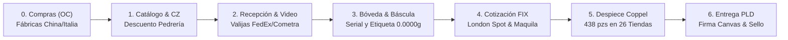

# 📘 Manual Operativo y Guion de Presentación: Demo MARTELA Joyería Fina

Este manual está diseñado como una **guía ejecutiva y operativa paso a paso** para presentar la plataforma **MARTELA** a directivos, socios comerciales y usuarios operativos. Describe el flujo completo desde que se genera una orden de compra internacional hasta que las joyas son entregadas y selladas con expediente legal PLD.

---

## 🚀 1. Preparación Rápida para la Presentación (2 Minutos)

### Enlaces de Acceso
* **En Vivo por Internet (Recomendado):**  
  👉 **[https://kikegithub.github.io/martela_app/](https://kikegithub.github.io/martela_app/)**
* **En Red Local (Offline / Sin Internet):**  
  Doble clic en `iniciar-demo.bat` o abrir el archivo `workspace/demo/index.html` en Chrome o Edge.

### Datos de Acceso Demo
* **Contraseña General:** `martela123`
* **Perfiles con 1 Clic:** La pantalla de inicio cuenta con botones de acceso directo para los 6 roles del sistema.

### El Botón Salvavidas (`↻ Restablecer Demo`)
En la barra superior de la aplicación hay un botón circular con el icono **`↻`**. Si realizaste pruebas previas y deseas que toda la base de datos vuelva a su estado original impecable para la reunión, haz clic en él y confirma.

---

## 🔄 2. Mapa General del Flujo Operativo

---

## 🎬 3. Guion de Presentación Pantalla por Pantalla

---

### PANTALLA 0: Acceso al Sistema y Roles Operativos (RBAC)

* **Objetivo:** Mostrar seguridad corporativa y control de acceso por perfil sin pantallas abrumadoras.
* **Quién opera:** Carlos Mendoza (Dirección General) o cualquier operador.
* **Qué hacer en pantalla:**
  1. Muestra la pantalla de acceso limpia con el logotipo oficial de **MARTELA**.
  2. En la cuadrícula de **Acceso Rápido por Perfil**, haz clic en **Dirección (Carlos Mendoza)**. El sistema ingresará de inmediato con privilegios completos.
* **Mensaje clave para el cliente:**
  > *"La plataforma cuenta con control de acceso por roles (RBAC). Si ingresa el chofer de custodia, únicamente verá su ruta de entrega; si ingresa la jefa de compras, operará las órdenes internacionales y packing list; y la dirección tiene visibilidad total del negocio"*.

---

### MÓDULO 0: Compras Internacionales (OC) & Auditoría de Embalaje

* **Objetivo:** Controlar el ciclo de importación con proveedores de China, Italia y Turquía, eliminando pérdidas por sobrepeso o discrepancias en aduana.
* **Quién opera:** **Karina Cruz** (Compras Internacionales & Abastecimiento).
* **Pestañas y Acciones a Demostrar:**

  1. **1. Gestor de Órdenes (OC):**
     * Muestra la tabla de órdenes en curso y el pipeline superior de 7 fases.
     * Señala la orden **`OC-2026-003`** (Shenzhen Finefey Jewelry - China) o **`OC-2026-005`** (Italoro Arezzo - Italia).
     * Haz clic en el botón **`Packing`** de la orden `OC-2026-003`.

  2. **2. Mesa de Auditoría de Packing List (±5%):**
     * **El momento clave:** Explica que los talleres en el extranjero envían el packing list con diferencias de peso respecto a la orden original.
     * Muestra el **Semáforo de Tolerancia (±5%)**:
       * En `OC-2026-003`, la variación es de **+1.2%**, el sistema muestra **APROBADO DENTRO DE TOLERANCIA (±5%)** y permite avanzar.
       * Si seleccionas la orden `OC-2026-004`, la variación es de **+7.8%**, y el sistema **BLOQUEA AUTOMÁTICAMENTE EL AVANCE**, alertando que supera la tolerancia permitida.
     * Haz clic en **`Aprobar Packing y Pasar a Fijación de Metal`**.

  3. **3. Cierre de FIX Internacional & Liquidación:**
     * Muestra el desglose de liquidación en dos componentes:
       * **Renglón 1:** Mano de Obra (Hechura en USD / Moneda origen).
       * **Renglón 2:** Metal fino según cotización London Spot fijada.
     * Haz clic en **`Confirmar Fix y Registrar Liquidación`**.

  4. **4. Tracking Aduanal & Enlace a Bóveda:**
     * Muestra la guía aérea FedEx/Cometra asignada (`FDX-7894512039-HK`).
     * Haz clic en **`Recibir en Mesa de Recepción de Valijas`** para transferir el lote al Módulo 2.

  5. **5. Estados de Cuenta de Proveedores:**
     * Muestra el saldo vivo consolidado por fabricante, historial de pagos, notas de crédito y facturas comerciales pendientes.

---

### MÓDULO 1: Catálogo de Joyería, Matriz CZ y Equivalencias

* **Objetivo:** Resolver el caos de códigos entre fabricantes extranjeros y el catálogo oficial mexicano de 14 dígitos, descontando la pedrería para no pagar piedras al precio del oro.
* **Quién opera:** Karina Cruz / Almacén Central.
* **Qué hacer en pantalla:**
  1. En el buscador predictivo, escribe `FF-8821` o `Anillo Solitario`. Verás que filtra al instante entre más de 2,200 modelos maestros.
  2. Muestra la columna **Descuento Circonia (CZ)**:
     * Señala el chip **`💎 -0.1800 g CZ`**:
       > *"Aquí resolvemos un problema histórico: cuando el fabricante entrega una joya con piedras sintéticas suizas (CZ), el sistema descuenta exactamente el peso de la pedrería a 4 decimales. Así el inventario y el costo reflejan exclusivamente el oro puro real"*.
  3. Haz clic en el botón **`Editar`** de cualquier producto:
     * Muestra el modal compacto: cambia el peso de circonia o el quilataje y observa cómo recalcula en vivo.
  4. Muestra el botón **`📥 Exportar Excel`**: genera la lista completa de modelos con equivalencias de fábrica en formato `.xlsx`.

---

### MÓDULO 2: Recepción, Video-Evidencia y Mesa de Calidad

* **Objetivo:** Blindar la empresa ante faltantes en paquetería internacional mediante video-evidencia obligatoria y control de mermas.
* **Quién opera:** **David Morales** (Recepción y Calidad).
* **Qué hacer en pantalla:**
  1. Selecciona la valija **`REC-2026-0101`** (Guía FedEx `FDX-7894512039-HK`, 4 bultos, 2,840.50 g brutos).
  2. Haz clic en **`Ver Video-Evidencia`**:
     * Muestra el visor multimedia simulado con la grabación cenital de desempaque y verificación de sellos aduanales intactos.
  3. Pasa al **Paso 2: Mesa de Calidad**:
     * Muestra el **Semáforo de Inspección**:
       * Botón verde **`+1 Aprobado`**: Joyas que pasan directo a bóveda.
       * Botón amarillo **`+1 Reparación`**: Piezas con broche flojo o pedrería desalineada para taller de ajuste.
       * Botón rojo **`+1 Merma Técnica`**: Piezas defectuosas devueltas al proveedor o enviadas a fundición.
     * Haz clic en **`Enviar Lote Inspeccionado a Bóveda Central`**.

---

### MÓDULO 3: Bóveda, Báscula Analítica e Identificación Individual

* **Objetivo:** Demostrar cómo superamos a ASPEL-SAE: ningún anillo pesa lo mismo y cada joya física tiene su propio número de serie y metrología.
* **Quién opera:** **Elisa Ramírez** (Báscula y Bóveda).
* **Qué hacer en pantalla:**
  1. En la tabla de joyas en bóveda, muestra cómo cada registro tiene su ID de serie único (`PZ-2026-0501`, `PZ-2026-0502`).
  2. Haz clic en el botón **`⚖️ Pesar en Báscula Digital`**:
     * Muestra la simulación de pesaje digital de alta precisión:
       * **Peso Bruto Báscula:** `2.3800 g`
       * **Descuento Pedrería CZ:** `-0.1800 g`
       * **Peso Neto de Oro:** `2.2000 g`
       * **Oro Fino Puro (Ley .417 / 10K):** `0.91667 g Au Fino` (a 5 decimales).
  3. Selecciona la **Ubicación en Bóveda**: Gaveta `A-101 (Bóveda Principal de Oro)`.
  4. Haz clic en **`Guardar Pesaje y Generar Etiqueta`**:
     * Se despliega la vista previa de la **Etiqueta Térmica de Joyería** con código de barras, modelo, peso bruto, peso neto y fecha de sellado.

---

### MÓDULO 4: Cotización FIX, Liquidación y Maquila 24K

* **Objetivo:** Blindar el margen comercial ante la fluctuación del precio internacional del oro y liquidar cuentas de clientes mayoristas que aportan metal propio.
* **Quién opera:** **Adriana López** (Finanzas y FIX).
* **Qué hacer en pantalla:**
  1. **La Regla de Oro (Mayor valor Hoy vs Ayer):**
     * Muestra la cabecera: FIX Hoy ($2,650 USD) vs FIX Ayer ($2,680 USD).
     * Señala la etiqueta: **`TARIFA VIGENTE APLICADA: $2,680.00 USD (Mayor Valor)`**.
     > *"Si el oro baja hoy, el sistema aplica la cotización de ayer para proteger la compra previa; si sube hoy, aplica la de hoy. Martela jamás queda descalzada"*.
  2. **Facturación Bipartita en 2 Renglones:**
     * Muestra cómo la cotización desglosa legalmente la operación:
       * **Renglón 1:** Mano de obra y maquila (sujeta a IVA / Margen comercial).
       * **Renglón 2:** Metal oro fino puro (exento / tasa cero según legislación fiscal de metales).
  3. **Pestaña Cuenta de Maquila y Compensaciones:**
     * Muestra el saldo a favor de clientes como Montepío o mayoristas que depositan barras de oro fino 24K:
       * El sistema descuenta gramos de metal puro de su saldo y cobra únicamente la hechura en pesos mexicanos.

---

### MÓDULO 5: Despiece B2B Coppel (26 Sucursales / 438 Piezas)

* **Objetivo:** Resolver el mayor dolor de cabeza semanal de la empresa: surtir el pedido masivo de Coppel sin errores y en minutos.
* **Quién opera:** Karina Cruz / Almacén Central.
* **Qué hacer en pantalla:**
  1. Muestra el pedido semanal activo: **`COP-2026-W42`** (438 piezas distribuidas en 26 sucursales del país: Puebla, San Luis Potosí, Tecámac, Culiacán, etc.).
  2. **El Momento WOW de la Presentación:**
     * Haz clic en el botón **`⚡ Asignar Piezas Automáticamente`**.
     * En menos de 1 segundo, el algoritmo recorre la bóveda física, toma las 438 joyas individuales por número de serie y gramaje real, y las asigna a cada una de las 26 cajas.
     * La barra de progreso se llena al 100% en color verde: **`438 / 438 Piezas Asignadas (100% Conciliado)`**.
  3. Muestra el número de sello plástico de seguridad foliado asignado al lote: **`Z008340`**.
  4. Haz clic en **`Exportar Layout Excel (.xlsx)`**:
     * Muestra el archivo Excel descargado con las **16 columnas exactas** requeridas por el portal B2B de Coppel (SKU, Centro Logístico, Peso Bruto, Peso Neto, Costo M.O., Margen MLS 70%, Factura SAE).

---

### MÓDULO 6: Logística Móvil, Custodia y Expediente PLD

* **Objetivo:** Garantizar la cadena de custodia en transporte de valores y generar el expediente legal antilavado (PLD) para blindaje fiscal y penal.
* **Quién opera:** **Miguel Torres** (Chofer de Custodia) / Adriana López (Cumplimiento PLD).
* **Qué hacer en pantalla:**
  1. Simulación de la aplicación móvil PWA para el custodio en ruta.
  2. Muestra la parada en destino: Centro de Distribución Coppel Puebla.
  3. **Validación de Precinto de Seguridad:**
     * El custodio verifica en pantalla que el precinto físico coincida con el registrado en sistema: **`Z008341`**.
  4. **Firma Digital Táctil en Canvas:**
     * Dibuja una firma en el recuadro interactivo (simulando la recepción por parte del gerente del CEDIS).
     * El sistema encripta la firma en Base64 con fecha, hora y geolocalización.
  5. Haz clic en **`Confirmar Entrega y Sellar Expediente PLD`**:
     * Se genera el expediente digital con folio único **`PLD-EXP-2026-3050`**, sellado con hash SHA-256 no editable, listo para auditorías del SAT o la CNBV.

---

### CIERRE: Exportador SQL PostgreSQL de 17 Tablas Normalizadas

* **Objetivo:** Demostrar a los auditores técnicos que no es una simulación superficial, sino una base de datos empresarial sólida.
* **Qué hacer en pantalla:**
  1. En la cabecera superior derecha, haz clic en el botón **`🐘 Exportar SQL Postgres`**.
  2. Se descargará el archivo `martela_database_dump.sql` (más de 1.2 MB de script DDL/DML real).
  3. Explica que contiene las 17 tablas relacionales listas para conectarse directamente a un backend en PostgreSQL / Java Spring Boot.

---

## 📊 4. Inventario de Datos Simulados Precargados

Para que tengas absoluta seguridad durante tu presentación, estos son los registros precargados y listos para mostrar:

| Módulo | Datos Precargados en el Sistema | Detalles Técnicos a Mencionar |
| :--- | :--- | :--- |
| **0. Compras (OC)** | **8 Órdenes de Compra Completas** (`OC-2026-001` a `OC-2026-008`) que cubren cada una de las 7 fases del ciclo | Proveedores: Shenzhen Finefey (China), Italoro Arezzo (Italia), Lotus Istanbul (Turquía). Candado ±5% funcional. |
| **1. Catálogo** | **2,232 Modelos Maestros** con SKU de 14 dígitos | Equivalencias de fábrica, metales (10K, 14K, 18K, .925) y calibración de pedrería CZ a 4 decimales. |
| **2. Recepción** | Valijas **`REC-2026-0101`** y **`REC-2026-0102`** | Guías reales FedEx Priority y Cometra Blindados con video-evidencia cenital y semáforo de 3 vías. |
| **3. Bóveda** | Piezas individuales **`PZ-2026-0501`** en adelante | Báscula analítica digital (0.0000g), gavetas blindadas (`A-101`, `B-201`) e impresión de etiquetas térmicas. |
| **4. Cotización** | Tarifas históricas de London Spot FIX y Dólar FIX | Comparativa Hoy ($2,650) vs Ayer ($2,680), desglose M.O./Metal y cuentas de maquila 24K de Montepío. |
| **5. Despiece B2B** | Pedido **`COP-2026-W42`** (438 piezas en 26 tiendas) | Algoritmo de asignación en 1 segundo, sellos de seguridad foliados y layout Excel de 16 columnas. |
| **6. Entrega PLD** | Expediente **`PLD-EXP-2026-3050`** y ruta de custodia | Validación de precinto `Z008341`, firma táctil en Canvas Base64 y geolocalización de entrega. |

---

## 💡 5. Consejos Clave para Triunfar en la Presentación

1. **No hables de tecnología, habla de dinero y tranquilidad:**
   * En vez de decir *"es una base de datos LocalStorage con JavaScript modular"*, di:  
     *"El sistema impide que paguen pedrería sintética a precio de oro y evita pérdidas por variaciones de gramaje en aduana"*.
2. **Haz que los usuarios interactúen:**
   * Invita al director o a la jefa de compras a presionar el botón de **`⚡ Asignar Piezas Automáticamente`** en Coppel o el botón de **`⚖️ Pesar en Báscula`**. Cuando vean la velocidad de respuesta, el impacto será contundente.
3. **Usa el modo oscuro para deslumbrar:**
   * Si la sala de juntas tiene proyector o pantalla de alta definición, activa el **Modo Oscuro** con el botón superior para mostrar la sofisticación estética de la plataforma.
