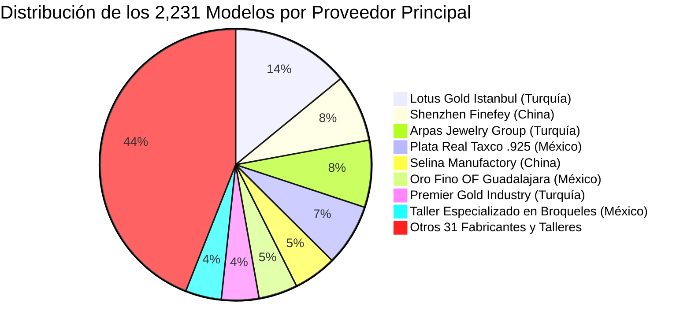
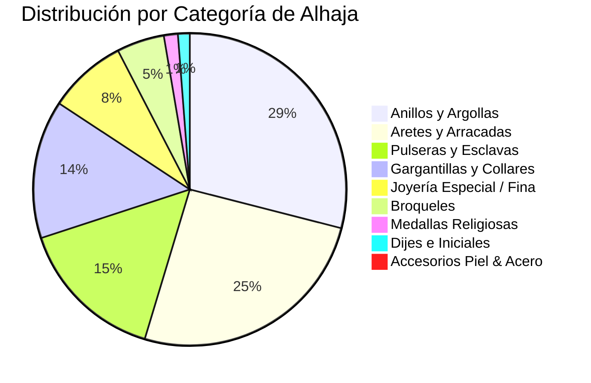

# 🏢 Concentrado Maestro de Proveedores y Catálogo de Productos MARTELA

Documento técnico y de negocio generado a partir del análisis integral del libro oficial de trabajo:  
**`workspace/docs/workbook/ALTAS Y SKUS DE MODELOS PROVEEDORES 02-03-26.xlsx`**

---

## 📊 1. Resumen Ejecutivo del Libro de Trabajo

| Métrica Global | Valor Real Extraído | Observaciones de Negocio |
| :--- | :---: | :--- |
| **Total de Pestañas Analizadas** | **53 hojas** | Distribuidas por proveedor, taller de maquila, tipo de metal y familias joyeras. |
| **Total de Modelos / Productos Extraídos** | **2,231 SKUs** | Piezas con Modelo Martela oficial, descripción, peso en báscula y código de barras. |
| **SKUs Únicos con Estándar 14 Dígitos** | **2,181 SKUs** | Código de barras estándar nacional e internacional (EAN/GTIN-14 oficial). |
| **Total de Proveedores y Talleres** | **39 Fabricantes** | 18 Proveedores Internacionales de Importación + 21 Talleres Nacionales de Hechura. |
| **Rango de Calibración de Circonias (CZ)** | **0.0000 g a 1.1200 g** | Calibración a 4 decimales para descuento automático en báscula digital. |
| **Volcado SQL PostgreSQL Generado** | **1.24 MB** | Scripts DDL e `INSERT INTO` listos para migración a base de datos relacional. |

---

## 🌍 2. Concentrado de los 39 Proveedores y Talleres

Los 39 proveedores se clasifican según su naturaleza logística en **Proveedores Internacionales de Importación** (valijas aduanales FedEx/Cometra) y **Talleres Nacionales de Hechura y Maquila**:

### Tabla Maestra de Proveedores Oficiales (39 Fabricantes)

| # | Código Interno | Razón Social / Nombre Comercial | País y Ciudad | Tipo | Moneda | Lead Time | Modelos Suministrados | Metales / Quilatajes |
| :-: | :--- | :--- | :--- | :---: | :---: | :---: | :---: | :--- |
| 1 | `PROV-TUR-04` | **Lotus Gold & Silver Istanbul** | 🇹🇷 Turquía (Estambul) | `INTERNACIONAL` | USD | 65 días | **328 SKUs** | Oro 14K, Oro 10K |
| 2 | `PROV-CHN-01` | **Shenzhen Finefey Jewelry Co., Ltd** | 🇨🇳 China (Shenzhen) | `INTERNACIONAL` | USD | 90 días | **187 SKUs** | Plata .925 |
| 3 | `PROV-TUR-05` | **Arpas Jewelry Group** | 🇹🇷 Turquía (Estambul) | `INTERNACIONAL` | USD | 70 días | **186 SKUs** | Oro 14K, Oro 10K |
| 4 | `PROV-MEX-07` | **Plata Real Taxco .925** | 🇲🇽 México (Taxco) | `NACIONAL` | MXN | 12 días | **172 SKUs** | Plata .925 |
| 5 | `PROV-CHI-05` | **Selina Jewelry Manufactory** | 🇨🇳 China (Guangzhou) | `INTERNACIONAL` | USD | 90 días | **120 SKUs** | Plata .925 |
| 6 | `PROV-MEX-06` | **Oro Fino (OF) Guadalajara** | 🇲🇽 México (Guadalajara) | `NACIONAL` | MXN | 15 días | **108 SKUs** | Oro 14K, Oro 10K |
| 7 | `PROV-TUR-07` | **Premier Gold Industry** | 🇹🇷 Turquía (Estambul) | `INTERNACIONAL` | USD | 65 días | **104 SKUs** | Oro 14K, Oro 10K |
| 8 | `PROV-MEX-08` | **Taller Especializado en Broqueles** | 🇲🇽 México (Guadalajara) | `NACIONAL` | MXN | 10 días | **100 SKUs** | Oro 14K, Oro 10K |
| 9 | `PROV-TAI-09` | **Joielle Jewelry (Pandora Style)** | 🇹🇭 Tailandia (Bangkok) | `INTERNACIONAL` | USD | 75 días | **83 SKUs** | Plata .925 |
| 10 | `PROV-IND-10` | **ACPL Exports Pvt. Ltd.** | 🇮🇳 India (Agra) | `INTERNACIONAL` | USD | 75 días | **76 SKUs** | Plata .925 |
| 11 | `PROV-TUR-11` | **Gusto Jewelry International** | 🇹🇷 Turquía (Estambul) | `INTERNACIONAL` | USD | 65 días | **66 SKUs** | Oro 14K, Oro 10K |
| 12 | `PROV-TUR-12` | **Goldenline Kuyumculuk** | 🇹🇷 Turquía (Estambul) | `INTERNACIONAL` | USD | 65 días | **57 SKUs** | Oro 14K, Oro 10K |
| 13 | `PROV-HON-13` | **Sunrise Silver Jewelry HK** | 🇭🇰 Hong Kong | `INTERNACIONAL` | USD | 75 días | **55 SKUs** | Plata .925 |
| 14 | `PROV-MEX-14` | **Diana Joyas Guadalajara** | 🇲🇽 México (Guadalajara) | `NACIONAL` | MXN | 15 días | **50 SKUs** | Oro 14K, Oro 10K |
| 15 | `PROV-ITA-03` | **VIOR S.p.A. Italy** | 🇮🇹 Italia (Vicenza) | `INTERNACIONAL` | EUR | 60 días | **42 SKUs** | Plata .925 |
| 16 | `PROV-MEX-16` | **Taller de Iniciales & Letras** | 🇲🇽 México (Guadalajara) | `NACIONAL` | MXN | 12 días | **39 SKUs** | Oro 14K, Plata .925 |
| 17 | `PROV-CHI-17` | **Soul Pearl Freshwater Culture** | 🇨🇳 China (Zhuji) | `INTERNACIONAL` | USD | 90 días | **38 SKUs** | Oro 14K (Perla natural) |
| 18 | `PROV-ITA-18` | **Italoro S.p.A.** | 🇮🇹 Italia (Vicenza) | `INTERNACIONAL` | EUR | 60 días | **37 SKUs** | Oro 14K, Oro 10K |
| 19 | `PROV-MEX-19` | **Taller Guzmán Joyeros GDL** | 🇲🇽 México (Guadalajara) | `NACIONAL` | MXN | 14 días | **34 SKUs** | Oro 10K |
| 20 | `PROV-MEX-20` | **Joyería Gordillo Hnos.** | 🇲🇽 México (Guadalajara) | `NACIONAL` | MXN | 14 días | **31 SKUs** | Oro 14K |
| 21 | `PROV-MEX-21` | **Taller Religioso & Medallas** | 🇲🇽 México (CDMX) | `NACIONAL` | MXN | 10 días | **28 SKUs** | Oro 10K |
| 22 | `PROV-MEX-22` | **Geovanni Joyería Fina** | 🇲🇽 México (Guadalajara) | `NACIONAL` | MXN | 14 días | **28 SKUs** | Oro 14K |
| 23 | `PROV-MEX-23` | **Taller de Plata Eduardo Acevedo** | 🇲🇽 México (Taxco) | `NACIONAL` | MXN | 12 días | **28 SKUs** | Plata .925 |
| 24 | `PROV-MEX-24` | **Taller de Oro Boleado & Bolas** | 🇲🇽 México (Guadalajara) | `NACIONAL` | MXN | 12 días | **25 SKUs** | Oro 14K, Oro 10K |
| 25 | `PROV-MEX-25` | **Taller Eduardo M.O. Oro** | 🇲🇽 México (Guadalajara) | `NACIONAL` | MXN | 14 días | **22 SKUs** | Oro 10K |
| 26 | `PROV-IND-26` | **PT Indonesia Gold Industry** | 🇮🇩 Indonesia (Yakarta) | `INTERNACIONAL` | USD | 75 días | **22 SKUs** | Oro 10K |
| 27 | `PROV-MEX-27` | **Manufacturas de Piel & Acero** | 🇲🇽 México (León / CDMX) | `NACIONAL` | MXN | 10 días | **21 SKUs** | Piel y Acero |
| 28 | `PROV-HKG-02` | **HK Gracey Jewel Co. Ltd** | 🇭🇰 Hong Kong (Kowloon) | `INTERNACIONAL` | USD | 75 días | **19 SKUs** | Plata .925 |
| 29 | `PROV-MEX-29` | **Taller Uzman 14K** | 🇲🇽 México (Guadalajara) | `NACIONAL` | MXN | 14 días | **18 SKUs** | Oro 14K |
| 30 | `PROV-EST-30` | **NY Jewelry Diamond District** | 🇺🇸 EE.UU. (Nueva York) | `INTERNACIONAL` | USD | 45 días | **18 SKUs** | Oro 14K |
| 31 | `PROV-MEX-31` | **Taller Matrimonial & Argollas** | 🇲🇽 México (Guadalajara) | `NACIONAL` | MXN | 10 días | **16 SKUs** | Oro 14K |
| 32 | `PROV-MEX-32` | **Taller José Luis Oro & Hechura** | 🇲🇽 México (Guadalajara) | `NACIONAL` | MXN | 14 días | **15 SKUs** | Oro 10K |
| 33 | `PROV-MEX-33` | **Taller Especializado en Dijes 14K**| 🇲🇽 México (Guadalajara) | `NACIONAL` | MXN | 10 días | **13 SKUs** | Oro 14K |
| 34 | `PROV-MEX-34` | **Jessica Diseños en Plata** | 🇲🇽 México (Guadalajara) | `NACIONAL` | MXN | 12 días | **12 SKUs** | Plata .925 |
| 35 | `PROV-MEX-35` | **Brillantería & Alta Joyería Lalo**| 🇲🇽 México (CDMX) | `NACIONAL` | MXN | 15 días | **11 SKUs** | Oro 14K con Diamantes |
| 36 | `PROV-IND-36` | **Yogesh Diamond & Gems Export** | 🇮🇳 India (Mumbai) | `INTERNACIONAL` | USD | 75 días | **9 SKUs** | Oro 14K con Diamantes |
| 37 | `PROV-MEX-37` | **Alpha Joyeros 14K** | 🇲🇽 México (Guadalajara) | `NACIONAL` | MXN | 14 días | **8 SKUs** | Oro 14K |
| 38 | `PROV-TUR-38` | **Gold Mark Istanbul** | 🇹🇷 Turquía (Estambul) | `INTERNACIONAL` | USD | 65 días | **3 SKUs** | Oro 14K |
| 39 | `PROV-MEX-39` | **Taller Fuentes & Cadenas** | 🇲🇽 México (Guadalajara) | `NACIONAL` | MXN | 12 días | **2 SKUs** | Plata .925 |

---

## 💎 3. Distribución del Catálogo de Productos (2,231 SKUs)

### Por Tipo de Metal y Factor de Oro Fino
| Metal / Ley | Total Modelos | Factor Oro Fino 24K | Esquema de Cobro |
| :--- | :---: | :---: | :--- |
| **Oro 14K** | **966 modelos** (43.3%) | `0.58333` | Bipartita (Mano de Obra + Metal del día Fix) |
| **Plata .925** | **838 modelos** (37.6%) | `0.00000` | Retail comercial con margen del 70% + 16% IVA |
| **Oro 10K** | **406 modelos** (18.2%) | `0.41667` | Bipartita (Mano de Obra + Metal del día Fix) |
| **Piel / Acero** | **21 modelos** (0.9%) | `0.00000` | Precio unitario fijo mayorista |

### Por Categoría de Joyería

---

## 🛠️ 4. Integración en la Plataforma MARTELA

1. **Datos Maestros Centralizados:**
   - Archivo generado: [workspace/demo/js/catalog-master-data.js](file:///c:/Users/kike2/OneDrive/Escritorio/FullStack%20Pojects/Martela/martela-app/workspace/demo/js/catalog-master-data.js) (1.4 MB).
   - Inyectado en [index.html](file:///c:/Users/kike2/OneDrive/Escritorio/FullStack%20Pojects/Martela/martela-app/workspace/demo/index.html) y fusionado reactivamente en [data-seed.js](file:///c:/Users/kike2/OneDrive/Escritorio/FullStack%20Pojects/Martela/martela-app/workspace/demo/js/data-seed.js).
2. **Pestañas Dinámicas en Módulo 1:**
   - `[ 💎 Catálogo de Productos y SKUs (2,238) ]` con buscador predictivo reactivo, filtrado multi-criterio y paginación rápida (50 registros por página).
   - `[ 🏢 Concentrado Maestro de Proveedores (39) ]` con vista de directorio ejecutivo, países de origen y enlace en 1 clic para ver los modelos de cada taller.
3. **Persistencia y Base de Datos:**
   - Auto-migración en [api-facade.js](file:///c:/Users/kike2/OneDrive/Escritorio/FullStack%20Pojects/Martela/martela-app/workspace/demo/js/api-facade.js).
   - Exportador PostgreSQL en [db-tables-facade.js](file:///c:/Users/kike2/OneDrive/Escritorio/FullStack%20Pojects/Martela/martela-app/workspace/demo/js/db-tables-facade.js) con volcado SQL completo.

