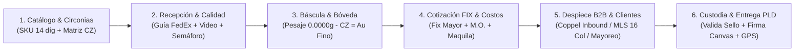

# 💎 Manual Operativo y Guía de Enseñanza Paso a Paso — Demo MARTELA (6 Módulos SDOP)

Este manual explica **qué hace cada pantalla**, **por qué fue diseñada así según las reglas reales de MARTELA**, **qué clic dar paso a paso**, cómo opera el **Control de Acceso por Roles (RBAC)** y **qué explicarle a tus usuarios o directivos** en cada uno de los **6 módulos de alto impacto**.

---

## 🗺️ 1. Visión General: El Flujo de Valor End-to-End de MARTELA

A diferencia de un ERP genérico (como Aspel-SAE) que solo cuenta piezas enteras con precios fijos, el flujo operativo de **MARTELA** sigue la vida física y financiera de cada joya desde que llega de importación hasta que se entrega sellada en tienda con expediente antilavado (PLD):



- **Fachada de Servicios Backend (`apiFacade`)**: Toda la lógica de negocio vive en [workspace/demo/js/api-facade.js](file:///c:/Users/kike2/OneDrive/Escritorio/FullStack%20Pojects/Martela/martela-app/workspace/demo/js/api-facade.js) (lista para recrearse 1 a 1 en **Spring Boot 3+**).
- **Fachada de Tablas PostgreSQL (`MartelaDbTablesFacade`)**: Las **13 tablas relacionales** viven aisladas en [workspace/demo/js/db-tables-facade.js](file:///c:/Users/kike2/OneDrive/Escritorio/FullStack%20Pojects/Martela/martela-app/workspace/demo/js/db-tables-facade.js) y pueden descargarse como script `.sql` desde el botón **`🐘 Exportar SQL Postgres`** de la barra superior.

---

## 🧭 2. Navegación Profesional y Menú Lateral Retráctil

La interfaz cuenta con un diseño institucional orientado a entornos de bóveda y alta dirección:
* **Íconos Vectoriales SVG Monocromáticos:** Sin emojis distractores ni colores excesivos; cada módulo posee una insignia técnica sobria.
* **Menú Retráctil (5rem ⇄ 16rem):**
  * Presiona el botón **`◀`** (ubicado junto al logo o en el pie del sidebar) para colapsar el menú lateral.
  * En modo compacto, el menú solo muestra los íconos técnicos, liberando el ancho total de pantalla para mesas de pesaje o auditoría de layouts extensos de 16 columnas.
  * Presiona el botón **`▶`** para volver a expandir los títulos y subtítulos explicativos.
  * El estado de colapso se guarda en `localStorage` (`martela_sidebar_collapsed`).

---

## 👥 3. Control de Acceso por Roles (RBAC) y Seguridad Contextual

Al abrir [http://localhost:8090/index.html](http://localhost:8090/index.html), verás la **Pantalla de Inicio de Sesión** ([workspace/demo/js/auth.js](file:///c:/Users/kike2/OneDrive/Escritorio/FullStack%20Pojects/Martela/martela-app/workspace/demo/js/auth.js)). El menú y los permisos se filtran automáticamente según el rol del usuario:

| Usuario / Actor Real | Rol en el Sistema | Contraseña | Módulos Visibles | Atribuciones y Candados en Pantalla |
| :--- | :--- | :---: | :--- | :--- |
| **Carlos Mendoza** (`admin`) | Dirección / Administrador General | `martela123` | **Los 6 módulos** (1 al 6) | Acceso maestro: alta de catálogo, calibración FIX, autorización de layouts, edición de Facturas SAE y auditoría PLD. |
| **David Morales** (`recepcion`) | Recepción, Video y Calidad | `martela123` | **Módulos 1, 2, 3 y 5** | Apertura de paquetes FedEx/Cometra, video-evidencia, semáforo de merma/taller y pesaje de entrada. |
| **Elisa Ramírez** (`boveda`) | Báscula Digital y Bóveda | `martela123` | **Módulos 1, 3 y 5** | Operación de báscula pieza por pieza, asignación de gavetas y surtido físico con sellos plásticos. **Candado:** En Módulo 5, el campo de Factura SAE queda bloqueado con `🔒 Gestionado por Finanzas`. |
| **Adriana López** (`finanzas`) | Motor Fix, Finanzas y PLD | `martela123` | **Módulos 1, 4, 5 y 6** | Supervisión del Fix del oro, debitación de cuentas de maquila (Montepío), captura de Facturas SAE y certificación de expedientes PLD. |
| **Miguel Torres** (`chofer`) | Chofer Custodio PWA Móvil | `martela123` | **Solo Módulo 6** | Su menú lateral se reduce exclusivamente a Custodia & Entrega PLD (pantalla optimizada para celular). |

> [!TIP]
> **Demostración en vivo:** Inicia sesión como **Carlos Mendoza (`admin`)**. Puedes cambiar de rol al instante utilizando el selector **"Rol Activo"** de la esquina superior derecha sin cerrar sesión para mostrar cómo se adaptan los candados de seguridad en pantalla.

---

## 📦 4. Recorrido Paso a Paso por cada uno de los 6 Módulos

---

### MÓDULO 1: Catálogo Maestro Multi-Proveedor y Matriz de Circonias (CZ)
- **Archivo:** [workspace/demo/js/modules/catalog.js](file:///c:/Users/kike2/OneDrive/Escritorio/FullStack%20Pojects/Martela/martela-app/workspace/demo/js/modules/catalog.js)
- **Datos Oficiales:** [workspace/demo/js/catalog-master-data.js](file:///c:/Users/kike2/OneDrive/Escritorio/FullStack%20Pojects/Martela/martela-app/workspace/demo/js/catalog-master-data.js) (39 Proveedores y 2,231+ Modelos del libro oficial).
- **Tablas BD:** `proveedores`, `productos_sku`, `proveedor_modelo_equivalencia`
- **Estructura por Pestañas:**
  - `[ 💎 Catálogo de Productos y SKUs ]`: 2,238 modelos con SKU de 14 dígitos (GTIN-14), buscador predictivo, filtros por metal/taller y paginación ágil de 50 items/página.
  - `[ 🏢 Concentrado Maestro de Proveedores ]`: Directorio de los 39 talleres internacionales (Turquía, China, Italia, etc.) y nacionales (GDL, Taxco, CDMX) con consulta directa de modelos.
- **Objetivo:** Es el **maestro teórico de ingeniería joyera**. Traduce el código de fábrica de 39 fabricantes al **Modelo Interno MARTELA** y al **Código de Barras Oficial SKU de 14 dígitos**, configurando el peso de circonia CZ (`0.0100 g` a `1.1200 g`) y el factor de oro fino automático (`0.41667` para 10K, `0.58333` para 14K, `0.00000` para Plata .925).
- **Atajos rápidos CZ en Modal:**
  - `0.0000g`: Sin piedra.
  - `0.1800g`: Solitario estándar.
  - `0.3600g`: Halo.
  - `0.7200g`: Pavé.
  - `1.1200g`: Dijes pesados.
- **¿Dónde consultar cuántas piezas hay de un SKU?** En el Catálogo se define la ficha técnica; las existencias físicas se consultan en el **Módulo 3 (Báscula & Bóveda)**, donde cada pieza física individual (`PZ-2026-XXXX`) está pesada y ubicada en su gaveta.

---

### MÓDULO 2: Recepción de Paquetería, Video-Evidencia y Mesa de Control de Calidad
- **Archivo:** [workspace/demo/js/modules/reception.js](file:///c:/Users/kike2/OneDrive/Escritorio/FullStack%20Pojects/Martela/martela-app/workspace/demo/js/modules/reception.js)
- **Tablas BD:** `recepciones_paqueteria`, `inspecciones_calidad`
- **Objetivo:** Registrar el peso bruto de la valija FedEx/Cometra y su video continuo de desempaque para reclamos en aduana, y clasificar cada pieza en la Mesa de Calidad hacia 3 destinos: **Báscula (Verde)**, **Taller de Reparación Interna (Amarillo)** o **Charola de Fundición (Rojo)**.
- **Pasos para demostrarlo:**
  1. Haz clic en **`🎥 Ver Video-Evidencia`** en la tarjeta de la guía `FDX-7894512039-HK`.
  2. En **`🔬 Paso 2: Mesa y Semáforo de Calidad`**, presiona **`↺`** en una fila y usa los botones **`+1 Aprobado`**, **`+1 Reparación`** y **`+1 Merma`** para ver el semáforo reactivo.
  3. Pulsa **`✓ Cerrar Acta y Enviar Aprobadas a Báscula`**.

---

### MÓDULO 3: Báscula Digital (4 Decimales), Sub-piezas y Almacén por Gavetas
- **Archivo:** [workspace/demo/js/modules/inventory.js](file:///c:/Users/kike2/OneDrive/Escritorio/FullStack%20Pojects/Martela/martela-app/workspace/demo/js/modules/inventory.js)
- **Tablas BD:** `ubicaciones_gavetas`, `piezas_inventario_individual`
- **Diferencia con el Módulo 1:** Módulo 1 es la **definición teórica**; Módulo 3 es el **almacén físico real** donde cada joya se pesa con 4 decimales, resta la piedra CZ del catálogo, calcula su Oro Fino Puro (5 decimales), recibe un serial individual `PZ-2026-XXXX` e imprime su etiqueta Zebra térmica.
- **Fórmula en vivo:**
  $$\text{Peso Neto Metal (g)} = \text{Peso Bruto Báscula (g)} - \text{Peso Piedra CZ (g)}$$
  $$\text{Oro Fino 24K (g)} = \text{Peso Neto Metal (g)} \times \text{Factor Oro Fino}$$
- **Pasos para demostrarlo:**
  1. Haz clic en el botón principal **`⚖️ Pesar Sub-pieza / Báscula Digital`** (o en **`⚖️ Pesar`** en cualquier fila del SKU en la tabla).
  2. En el **Modal de la Mesa de Pesaje**, elige el SKU `07502278209688` y la gaveta `BOVEDA-R1-N1-G01`.
  3. Haz clic en **`🎲 Pesar Otra`** (o captura `2.3800` en peso bruto) y señala en el display digital negro la ecuación en vivo: `Bruto 2.3800g - CZ 0.1800g = Neto Metal 2.2000g (0.91667g Oro Fino)`.
  4. Presiona **`Enter ↵`** o haz clic en **`🏷️ Grabar Pieza & Imprimir Etiqueta Térmica`** para abrir la etiqueta Zebra y ver la pieza agregada en la tabla máster de Bóveda.

---

### MÓDULO 4: Motor Financiero Fix, Oro Fino Puro y Facturación Bipartita
- **Archivo:** [workspace/demo/js/modules/pricing.js](file:///c:/Users/kike2/OneDrive/Escritorio/FullStack%20Pojects/Martela/martela-app/workspace/demo/js/modules/pricing.js)
- **Tablas BD:** `tasas_metal_fix`, `saldos_maquila_oro_fino`
- **Objetivo:** Aplicar la **Regla de Tarifa Máxima Fix (Hoy vs. Ayer)**, liquidar en esquema **Bipartito** (`Renglón 1: Costo M.O. por gramo` + `Renglón 2: Costo Metal por gramo`), calcular el precio público con **Margen 70% + IVA 16%** y llevar el saldo de **Oro Fino Puro 24K** en cuenta maquila (Montepío).
- **Pasos para demostrarlo:**
  1. Señala el badge verde **`TARIFA VIGENTE APLICADA ($2680.00 USD)`** que toma automáticamente el mayor entre Fix Hoy y Fix Ayer.
  2. Selecciona una sub-pieza física en el **Simulador de Liquidación Bipartita** y muestra el desglose de Renglón 1 (M.O.), Renglón 2 (Metal), Subtotal Martela, Margen 70%, IVA 16% y Gramos de Oro Fino a debitar.
  3. Haz clic en **`⚡ Simular Cargo de Oro Fino de la Pieza Cotizada a Cuenta Maquila`** para descontar en vivo los gramos 24K del saldo de Montepío.

---

### MÓDULO 5: Despiece B2B y Distribución Multi-Cliente (Arquitectura 3 Pestañas)
- **Archivo:** [workspace/demo/js/modules/coppel.js](file:///c:/Users/kike2/OneDrive/Escritorio/FullStack%20Pojects/Martela/martela-app/workspace/demo/js/modules/coppel.js)
- **Tablas BD:** `clientes_centros_logisticos`, `salidas_remisiones`, `salida_piezas_detalle`, `ordenes_coppel`

El Módulo 5 cuenta con un selector superior con 3 pestañas dinámicas que transmutan la interfaz según el cliente mayorista:

```
[ 🏢 Coppel B2B (Importar Pedido) ]  |  [ 🏛️ Montepío Luz Saviñón (MLS 16 Cols) ]  |  [ 🏬 Mayoristas & Boutiques ]
```

#### 🏢 Pestaña 1: Coppel B2B (Flujo Inbound — De Afuera hacia Adentro)
1. **Carga de Layout:** Sube el Excel semanal del portal de Coppel para 26-50 sucursales/CEDIS (Puebla, San Luis Potosí, Tecámac, Culiacán).
2. **Folio Único:** Genera consecutivos oficiales como `COP-2026-S46-7892`.
3. **Surtido Automático FIFO:** Haz clic en **`⚡ Asignar 438 Sub-piezas Automáticamente`** para asignar piezas disponibles en Bóveda (`PZ-2026-XXXX`).
4. **Descuento en Bóveda:** Al presionar **`🚚 Despachar a Ruta Logística`**, descuenta las existencias físicas de Bóveda y actualiza el kardex.

#### 🏛️ Pestaña 2: Montepío Luz Saviñón / MLS (Flujo Outbound — De Adentro hacia Afuera)
1. **4 Centros Logísticos:** `3032 Cancún`, `3050 Santa Fe Avant`, `4015 Ecatepec`, `4031 Texcoco`.
2. **Variantes de Cálculo:**
   - **Oro 10K / 14K:** Facturación bipartita, deducción de circonia CZ y débito directo de Oro Fino Puro 24K (`saldos_maquila_oro_fino`).
   - **Plata .925:** Margen retail del 70% + 16% de IVA sobre costo Martela.
3. **Seguridad y Trazabilidad:**
   - Captura de **Folio de Sello Plástico de Seguridad** (`Z008340`, `Z008336`).
   - Registro de **Peso Bruto con Bolsa Verificado en Báscula**.
4. **Entregables Oficiales:**
   - 📊 **`Layout Oficial 16 Columnas (.xlsx)`**: Excel idéntico al libro mayor de MARTELA con las 16 columnas exactas.
   - 📄 **`Remisión Oficial con Sello (.pdf)`**: Formato membretado con firmas de Almacén, Custodio y Sucursal.
5. **Control de Acceso RBAC:**
   - Si opera **Elisa (Bóveda)**: El folio de Factura SAE aparece bloqueado con el distintivo `🔒 Gestionado por Finanzas`.
   - Si opera **Adriana (Finanzas)** o **Carlos (Admin)**: El campo de Factura SAE está habilitado para edición contable.

#### 🏬 Pestaña 3: Mayoristas & Boutiques (Captura Libre)
1. **Cotización por SKU:** Selector de modelos del catálogo (`07502278209688`, etc.).
2. **Margen Dinámico:** Slider del 20% al 40% con recálculo de subtotal, IVA y total.
3. **Remisión Inmediata:** Descuenta inventario y emite la orden de venta mayorista.

---

### MÓDULO 6: Custodia & Entrega PLD, PWA Móvil para Choferes
- **Archivo:** [workspace/demo/js/modules/logistics.js](file:///c:/Users/kike2/OneDrive/Escritorio/FullStack%20Pojects/Martela/martela-app/workspace/demo/js/modules/logistics.js)
- **Tablas BD:** `pld_evidencias_entrega`
- **Objetivo:** PWA móvil (`390px`) con soporte **Offline-First** para el chofer custodio (**Miguel Torres**):
  1. Validar el **Folio del Sello de Seguridad Plástico** (`Z008341`).
  2. Capturar **coordenadas satelitales GPS**.
  3. Recoger **Firma Digital Táctil en Pantalla** (`Canvas HTML5`).
  4. Sellar el **Expediente PLD Inmutable** para la auditoría antilavado de Adriana.

---

## 🐘 5. Arquitectura Técnica y Exportador SQL PostgreSQL

1. **Exportación SQL PostgreSQL en 1 Clic:**
   - Haz clic en el botón superior **`🐘 Exportar SQL Postgres`**.
   - Descarga un archivo `.sql` generado en vivo por [db-tables-facade.js](file:///c:/Users/kike2/OneDrive/Escritorio/FullStack%20Pojects/Martela/martela-app/workspace/demo/js/db-tables-facade.js) con las sentencias `CREATE TABLE` e `INSERT INTO` de las **13 tablas del modelo de datos**.
2. **Restauración Rápida (`↻`):**
   - El botón **`↻`** en la barra superior limpia y restaura la base de datos a su estado inicial en 1 segundo.

---

## ⚡ 6. Paginación Universal & Feedback Visual de Transacciones (Loading)

Para garantizar un rendimiento óptimo de grado industrial con catálogos masivos (+2,200 SKUs y miles de piezas en bóveda):

1. **Paginador Universal Estandarizado:**
   - **Tamaño predeterminado:** **20 registros por página**.
   - **Selector de densidad:** Menú desplegable interactivo con opciones de **20**, **50** y **100** registros por página.
   - **Controles de navegación:** Botones de salto inicial (`⇤`), página anterior (`◀`), indicador numérico de página actual (`Página X de Y`), siguiente página (`▶`) y salto final (`⇥`).
   - **Leyenda de cobertura:** Conteo dinámico exacto (`Mostrando X - Y de Z registros`).
   - **Presencia universal:** Activo en todas las tablas del sistema: Catálogo de SKUs, Concentrado de Proveedores, Semáforo de Recepción, Bóveda General, Log de Maquila 24K, Órdenes Coppel, Selección Montepío MLS, Remisiones Oficiales MLS, Partidas de Mayoreo, Expedientes PLD, Facturas CFDI 4.0, Recibos REP, Notas de Crédito, Clientes Fiscales, Lotes de Fundición, Stock de Campeones y Auditoría General.

2. **Feedback Visual de Carga (Loading):**
   - **Transacciones Críticas (`withLoading`):** Muestra el overlay modal con spinner dorado institucional y mensaje contextual (ej. *'Timbrando factura ante el PAC...'*, *'Conciliando lote de fundición...'*, *'Exportando existencias...'*), garantizando una visibilidad mínima táctil de ~300ms para evitar parpadeos y dar certeza al usuario de que la operación concluyó.
   - **Transiciones Instantáneas (`flashLoading`):** Micro-feedback no invasivo para cambios de página, filtros predictivos y alternancia de densidad (20/50/100).
   - **Seguridad en Fallos:** Implementado bajo bloques `try / finally` para garantizar que la interfaz jamás quede bloqueada ante excepciones de red o validación.
